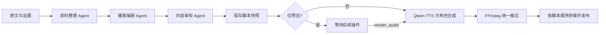

# 文本转双人播客工作台

将中文文章或笔记制作成双人播客，支持脚本审校、多轮修改、双音色语音、播放和下载。

当前工作分支新增 **Edge 在线配音（默认）**，保留千问切换；原 v0.1.0-backend-preview 标签仍对应先前的千问后端版本。三 Agent、脚本修改、双引擎语音、后台任务、API 和命令行入口已实现，前端仍未连接。

真实 DeepSeek／千问联调仍待填写密钥。Edge 已完成 9.24 秒双人真实试音，不等于完整播客端到端验收。切换方式和记录见 [Edge 配音说明](docs/edge-tts.md)；原版本细节见[版本说明](docs/releases/v0.1.0-backend-preview.md)，操作见[后端验收步骤](docs/acceptance.md)。

## 已确定的技术方向

- LangGraph 编排资料整理、播客编剧、内容审校三个 Agent。
- DeepSeek 承担文字模型调用；日常默认 Edge 配音，课程验收可切回千问 Qwen-TTS。
- 默认一次生成完整节目，可选择先预览脚本。
- FastAPI、SQLite、原生网页；完整成品成功后发布，保留旧版本。

用户已明确选择直接基于 LangGraph 开发，不依赖教师的 langraph_agent 框架。该选择与原任务书的指定框架要求存在差异，其余适用要求继续执行。

## 设计文件

- [需求与设计](docs/superpowers/specs/2026-10-24-podcast-workbench-design.md)
- [实施计划](docs/superpowers/plans/2026-10-24-podcast-workbench.md)

## 本地安装与配置

需要 Python 3.11+。本次开发环境为 Windows、Python 3.12.4，虚拟环境位于项目的 .venv。
以下 PowerShell 命令在仓库根目录执行，不需要激活脚本：

```powershell
python -m venv .venv
& .\.venv\Scripts\python.exe -m pip install -e ".[dev]"
if (-not (Test-Path -LiteralPath .env)) {
    Copy-Item -LiteralPath .env.example -Destination .env
}
```

如果 .env 已存在，不重复复制，以免覆盖本地配置。推荐使用已提交的 uv.lock 复现本次依赖版本：

```powershell
uv sync --extra dev --locked
```

本项目当前的 .venv 已创建且依赖已安装，无需重复创建。默认 Edge 模式只需本地填写 DEEPSEEK_API_KEY；千问模式另需 DASHSCOPE_API_KEY。不要将密钥发送到聊天中。

本阶段已验证 LangGraph 1.2.17、FastAPI 0.162.0 可导入。完整的依赖解析版本见 uv.lock；pip 安装路径使用 pyproject.toml 声明的兼容范围，不保证与锁定文件完全相同。

配置优先级为进程环境 > 本地 .env > 仓库 .env.example 中的非敏感默认值。config.yaml 的 api_key 只能引用指定环境变量，明文密钥将被拒绝。运行命令需在仓库根目录执行，或使用 --config 指定配置路径；运行不改变当前进程的环境变量。

## 离线检查

```powershell
& .\.venv\Scripts\python.exe -m podcast_workbench doctor
& .\.venv\Scripts\python.exe -m podcast_workbench check-config
& .\.venv\Scripts\python.exe -m podcast_workbench check-config --require-secrets
```

doctor 和 check-config 均不发起网络请求、不计费。离线检查允许密钥为空；加 --require-secrets 后缺少密钥返回非零退出码，已填写也不表示真实供应商鉴权已通过。

项目依赖 imageio-ffmpeg，其常用平台的 wheel 随包提供 FFmpeg；已使用该二进制验证音频处理。查找顺序为 FFMPEG_PATH、系统 PATH、项目随包版本；不修改系统 PATH。发行方式见[依赖的官方说明](https://github.com/imageio/imageio-ffmpeg)。

## 不连接网页的命令行验收

填好本地 .env 后，在仓库目录运行：

```powershell
# 仅生成脚本：请求真实 DeepSeek，不请求千问 TTS。
& .\.venv\Scripts\python.exe -m podcast_workbench run --request-file examples/create-preview.json

# 生成完整节目：请求真实 DeepSeek 和当前 TTS 引擎（默认 Edge）。
& .\.venv\Scripts\python.exe -m podcast_workbench run --request-file examples/create-podcast.json
```

示例文件仅包含输入材料，不含预制答案或音频。run 会输出两行 JSON：第一行为会话、任务和 trace 标识，第二行为最终任务及产物。脚本和 WAV 在本地 output/，日志在 logs/agent.log，数据库在 data/。命令成功退出为 0，任务失败为 1。失败可保留已有脚本和旧音频。

run 支持与 POST /chat 相同的 JSON 请求；连续修改、单独制作音频和查日志的完整命令见[验收步骤](docs/acceptance.md)。CLI 和 HTTP 服务不要同时运行，数据库恢复机制按单进程设计。

## 后端 API

目前没有运行中的服务或网页。需要单独验收 API 时，由用户手动运行：

```powershell
& .\.venv\Scripts\python.exe -m uvicorn podcast_workbench.api:create_app --factory --host 127.0.0.1 --port 8000
```

仅启动本地 API，不启动浏览器；未挂载静态页面、未启用 CORS，根路径和 /docs 返回 404。不要配置多 worker 或直接暴露公网。接口契约见 [API 说明](docs/api.md)，机器可读定义位于 /openapi.json。

| 接口 | 用途 |
| --- | --- |
| POST /chat | 提交 create／revise／render_audio，返回 202 和任务标识 |
| GET /jobs/{job_id} | 查询阶段、状态、安全错误及对应脚本版本的产物 |
| GET /sessions/{session_id} | 恢复原材料、消息、当前脚本和上一版成功音频 |
| GET /sessions/{session_id}/artifacts | 获取结构化产物列表，返回 URL、不返回本地路径 |
| GET /artifacts/{artifact_id} | 音频 Range 播放或脚本读取；加 download=true 下载 |
| GET /health | 配置与 FFmpeg 状态，不返回密钥；不表示真实鉴权已通过 |

## 接口参数核实

2026-10-24 按官方文档核实：

- DeepSeek 默认使用 deepseek-flash，模型可在 .env 修改；兼容接口基础地址为 https://api.deepseek.com。来源：[官方模型列表](https://api-docs.deepseek.com/quick_start/pricing/)。
- 千问保持任务书指定的 qwen3-tts-flash，使用北京地域的 multimodal-generation/generation 接口，Bearer 鉴权，请求 input 中包含 text、voice、language_type；返回 output.audio.url，有效期 24 小时。来源：[官方 API](https://help.aliyun.com/zh/model-studio/qwen-tts-api)。
- 千问每次输入最多 600 字符，脚本已按此分段。默认角色音色为 Cherry 和 Ethan，语言为 Chinese。来源：[官方音色列表](https://www.alibabacloud.com/help/en/model-studio/qwen-tts-voice-list)。
- 输入材料上限 20,000 字符、下载音频上限 20 MiB 是本项目的保护参数，不是供应商额度或容量承诺。

模型权限、服务额度、音色实际效果仍需后续真实调用验证。新版本服务不自动替换任务书指定的 TTS 协议。

## 验证命令

```powershell
& .\.venv\Scripts\python.exe -m pytest
& .\.venv\Scripts\python.exe -m ruff check .
& .\.venv\Scripts\python.exe -m mypy
```

[开发进度](docs/progress.md)记录用户确认的八阶段顺序和逐阶段验证结果。[第一版发布清单](docs/release-checklist.md)记录用户授权的远程发布条件和备注要求。

## 编排与护栏



pipeline 适合这条固定依赖链。三个 Agent 各有独立提示词和 JSON 输出校验，审校稿才成为最终脚本。纯音色调整跳过 LLM。角色不是三个聊天标签，而是三个实际模型调用节点。

- 图 recursion_limit=12，固定三节点，无无限审校回路。
- 每次 LLM/TTS 请求超时 90 秒；LLM 输出最多 6000 tokens，结构不合法最多额外请求一次，HTTP 失败不自动重试。
- 单次制作最多 48 个语音片段，单片不超过 600 字符；下载和完整音频均限制为 20 MiB。Edge 模式沿用这些项目护栏，不表示服务商官方配额。
- 单会话一个活动任务，进程同时最多四个任务；退出等待制作完成，强制中断在下次启动标记失败。
- 目标时长为参考；短材料优先忠实原文，实际时长由成品音频计算，不保证精确到秒。

## 数据与安全边界

- 创建材料会话，保存节目设置和消息；重新打开 SQLite 后仍可读取。
- 脚本按版本号保存独立快照，任务与产物关联明确的版本。
- 数据库唯一索引控制同一会话的活动任务；终态不能回退，遗留任务可在启动时标记中断。
- 新版失败不覆盖旧音频，音频元数据记录实际音色；发布时验证会话、版本及文件存在性。
- JSONL 日志只允许受控字段，不保存原始供应商响应与异常文本。

模块级使用示例：

```python
from pathlib import Path
from podcast_workbench.models import ProgramSettings
from podcast_workbench.store import Store

store = Store(Path("data/workbench.sqlite3"))
session_id = store.create_session("待制作播客的原文材料。", ProgramSettings())
session = store.get_session(session_id)
print(session.id, session.settings.target_minutes)
```

数据库包含原文和会话内容，虽然被 Git 忽略，仍需妥善保管。API 已将产物路径转换为索引 URL，禁止读取 output/ 之外的文件；WAV 下载和拼接均检查可解码性及完整帧数。音频片段按文本、角色、音色、模型、语言、服务地址及规范化格式指纹复用，缓存命中事件不会冒充供应商调用。

日志只记录受控事件、标识、阶段、耗时和安全错误分类，不保存密钥、材料、签名音频 URL 或供应商异常正文。测试使用临时数据和网络隔离；生产路径只调用真实供应商，没有假服务器或预制输出回退。

## 后续工作

1. 用户本地填密钥，按验收步骤核实真实调用、额度、音色、时长和内容质量。
2. 确定前端设计后再开发网页并对接，验证多轮交互及 422／502 提示。
3. 完成浏览器真实验收、6–8 分钟录屏、实际成员分工和学校模板报告。

阶段自查记录见[后端审核](docs/backend-review.md)。目前不包含联网选题、文件上传、背景音乐、音色克隆、生图、账号或自动平台发布。
