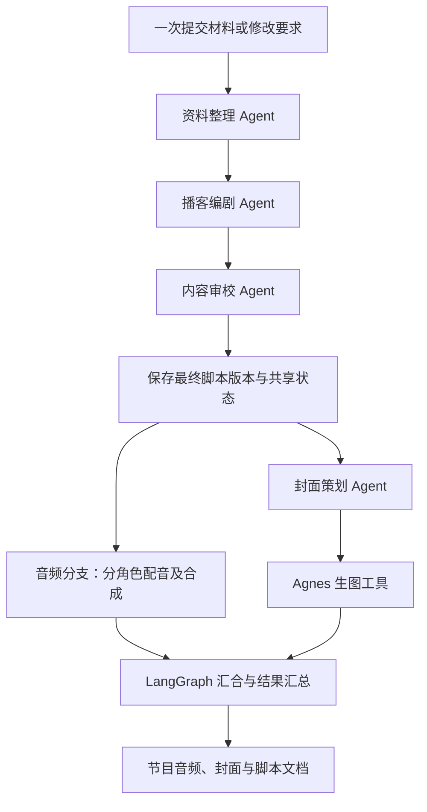

# LangGraph 自动协同制作

2026-10-24。默认操作改为粘贴材料后点击“一键生成完整节目”。Agent 之间通过共享的结构化状态交接，用户不需要逐步点击配音、封面策划或生图。

## 真实编排

production.py 使用 LangGraph StateGraph 构建制作总图；script_team 调用原有三 Agent 子图，保存审校后的不可变 Revision。之后音频节点与编译后的封面子图并行，全部结束后汇合，统一结束同一个 job。封面子图在自己的步骤内从策划推进到生图，避免父图 superstep 屏障让生图等待整段配音。

四个 LLM Agent 均使用 DeepSeek；Edge／Qwen 配音、Agnes 生图和音频合成是工具能力，不伪称额外 Agent。固定依赖决定使用 pipeline 加并行分支，不增加一个只负责转发的“主管 LLM”。

封面策划直接读取审校后的同一脚本版本，音频也使用这一版本。两个分支共用 trace_id、session_id、job_id 和 revision_id，输出在汇合后归属同一制作任务。音频与封面分支分别写入状态中的独立字段，避免并行状态互相覆盖。

## 默认与可选操作

- config.yaml 的 pipeline.auto_cover=true：完整节目默认自动制作封面；请求 auto_cover 可覆盖该开关。
- preview_only=true：仅运行三 Agent 脚本团队，主动暂停自动配音和生图，供需要先审稿的用户选择；默认不勾选。
- revise：默认同样自动完成新脚本、音频与封面。
- render_audio：仍支持只换声音，不重写脚本。
- plan_cover／generate_cover：保留为高级单项调整，不属于正常制作的必经手动操作。
- complete_program：一键补齐已有脚本版本的缺失产物。复用已成功的当前版音频、封面或封面策划，不重新调用无关 Agent；请求必须指定 session_id、当前 revision_id，可提供 auto_cover。

只换音色和其他明确的局部操作不强制重做封面。完整修改会形成新版本，旧版产物不作为新版本的成功结果。

## 失败与部分完成

脚本失败时不启动后续分支。某个产物分支失败时，另一个分支继续完成；任务最终标记 failed、partial=true，并返回明确 warnings，不能将部分完成标记成完整成功。

没有 Agnes 密钥时，封面策划跳过以免无谓消耗 LLM，封面标记未完成；脚本和音频仍可生成。完成页面提供“自动补齐本期节目”，配置修复后一次补齐，无需手动重复全部步骤。失败的音频分支同样不能阻断封面成功。

Job.node_states 保存各节点的 running／succeeded／failed／skipped 状态。前端同时展示音频和封面节点，避免拿单一 stage 字段伪装串行进度。Session.last_job 用于刷新后保留部分完成提示。日志新增 node.skip 事件，沿用同一 trace_id；图像 HTTP 错误只记录数值状态码，不记录供应商正文或密钥。

## 验证

单元与集成测试覆盖一次请求产出三类产物、四次真实客户端协议调用的隔离验证、并行启动、审校稿交接、单分支失败不阻断另一分支、缺密钥、预览暂停、关闭自动封面、一键补齐复用结果及版本互斥。

浏览器隔离测试 tests/browser-auto.cjs 覆盖默认一次提交、并行节点显示、部分完成后的刷新恢复和一键补齐；隔离测试不是外部供应商调用证据。真实联调结果另行记录，不以假响应冒充。

## 真实自动调用记录

本地已配置两家模型与 Edge。2026-10-24 使用仓库中已核实不含敏感信息的“播客改编流程”示例，仅 POST /chat 一次，返回 job_id=6a2cfcab-0299-4791-8ad6-a76cea7fd85c、session_id=b6afbbbd-b758-4ad3-bdf0-33f91c4b4967、trace_id=de713b9a-3524-4609-b1ff-6a0c421e5ab4。

四个 LLM Agent 与配音、生图、合成全部完成，status=succeeded、partial=false。音频 145.848 秒／7,000,748 字节，封面 1024×1024／818,899 字节，两项下载均返回 HTTP 200。已检查实际图片和网页恢复、缩略图及完整封面显示。真实产物和日志仅保存在本地 output/、logs/，不提交到 Git。

首次真实调用验证了完整自动业务链路，同时发现父图步间屏障会让生图等待音频。随后将封面改为子图，并使用“音频等待生图请求启动才允许结束”的回归测试验证真正分支并发；未为调度调整重复消耗真实服务额度。

最终自动检查：108 项 pytest、ruff、mypy 23 个源文件通过；两个浏览器交互检查及真实自动产物的网页恢复检查通过。
