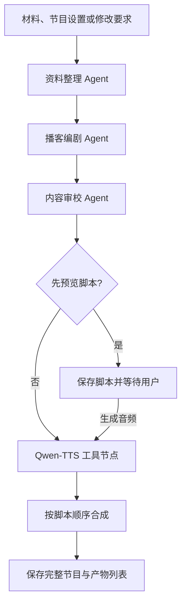

# 文本转双人播客工作台需求与设计

日期：2026-10-24。功能与交互依据本项目对话中已确认的第一版范围。

## 项目目标与约束

将用户粘贴的中文文章或笔记制作成双人播客，支持脚本预览、多轮修改、真实双音色语音、完整音频播放和下载。

用户已明确选择直接使用 LangGraph，不依赖教师的 langraph_agent 封装。这与原任务书的指定框架要求存在差异，不能声称该条已满足，也不能通过重新命名自建目录冒充原框架。其余适用要求继续落实。项目是否获得教师认可需由用户与教师确认。

本地仓库：D:\10.24\podcast-workbench。远程：https://github.com/l616974162-glitch/podcast-workbench.git。

## 第一版功能

1. 粘贴文本材料，填写可选节目主题。默认只依据材料生成，不进行联网检索。
2. 节目设置：普通大众／初学者／专业听众；轻松访谈／知识讲解；目标时长约 2／3／5 分钟。默认普通大众、轻松访谈、约 3 分钟。
3. 分析材料，展示可展开的关键事实、观点、讨论提纲和信息缺口。
4. 生成标题、简介、带角色标记的双人脚本。主持人提问串联，嘉宾解释分析；有开场、核心讨论和收尾。
5. 审校材料一致性、重复内容、角色衔接及口语表达，输出简要审校摘要。审校不等于正确性保证。
6. 默认一次生成完整节目；可勾选“先预览脚本，再生成音频”。
7. 使用不同音色制作两个角色的语音，分段生成后合成为完整节目。
8. 成品页优先展示标题、播放器、实际时长及下载入口；脚本、提纲、审校结果可展开。
9. 支持同一会话内的自然语言修改，以及缩短节目、讲得更通俗、调整音色三个快捷操作。
10. 支持下载完整音频和 UTF-8 文本脚本。
11. 显示阶段状态、session_id、每次操作的 trace_id；错误可读，失败操作可重试。

时长是生成目标，不承诺精确到秒。输入字符上限与单段 TTS 文本上限通过配置声明，并依据实际接口限制校验；超限时提示缩短，不静默截断。服务限制未核实前不得在界面宣称任意长度可用。

## 操作与版本规则

默认路径：粘贴材料 → 调整设置 → 生成播客 → 查看进度 → 收听／查看脚本 → 对话修改 → 生成新版 → 下载。

预览路径：粘贴材料 → 勾选先预览 → 生成并审校脚本 → 可继续修改 → 点击生成音频。

材料和节目设置在会话内保留。每次成功形成脚本创建不可变修订版本，音频关联明确的脚本版本及音色组合。脚本修改后，旧音频仍可播放，但标记“对应旧版脚本”。新版本全部合成成功后才成为当前成品；失败不覆盖上一版成功产物。

只换音色时复用脚本。改文本时先生成并审校完整的新脚本，保证上下文衔接，再按文本、角色、音色、模型、语言参数的内容指纹复用未变化的已成功音频片段。合成顺序始终取新脚本顺序，不能取下载完成顺序。

每个会话同一时间只执行一个制作或修改任务；重复请求返回可读冲突提示，避免并发覆盖版本。前端刷新后可通过 session_id 和任务标识恢复查看当前状态。第一版不支持服务进程重启后自动续跑未完成任务；中断任务应标记失败并允许重新发起。

## LangGraph 编排

采用固定 pipeline，原因是材料整理、脚本创作、审校、语音存在明确先后依赖，固定路径便于限制调用次数与逐阶段验收。

三个 Agent 均调用真实 DeepSeek，使用独立职责、提示词与结构化输出。整理 Agent 不新增事实；编剧 Agent 只能依据材料编排，解释性示例必须有明确标识；审校 Agent 可修订脚本，但不无限回退。结构校验失败最多额外请求一次，仍失败则明确结束任务。图的 recursion_limit、每次请求超时与输出上限在 config.yaml 中配置。

用户修改时，整理 Agent 同时接收原材料、当前脚本、节目设置和修改要求，形成修改提纲；后续继续通过编剧与审校。纯音色调整直接进入语音流程，不调用无关 Agent。

## 技术边界与目录

Python 3.11+、FastAPI、LangGraph、Pydantic、httpx、SQLite、原生 HTML/CSS/JavaScript。使用 SQLite 保存会话、修订版本、任务状态与产物索引；音频保存到本地 output/。第一版为单进程、本机使用，不包含多租户部署。

- src/podcast_workbench/config.py：读取 YAML、环境变量，验证配置。
- src/podcast_workbench/models.py：请求、脚本、任务、产物模型。
- src/podcast_workbench/llm.py：DeepSeek HTTP 调用、结构化输出解析。
- src/podcast_workbench/graph.py：三个 Agent 与条件分支。
- src/podcast_workbench/tools/base.py：工具 client 模板方法。
- src/podcast_workbench/tools/qwen_tts.py：千问请求构造、结果解析与音频下载。
- src/podcast_workbench/tools/registry.py：协议名到 client 的注册。
- src/podcast_workbench/audio.py：分段缓存、格式统一、按序合成与时长计算。
- src/podcast_workbench/store.py：SQLite 会话与版本存储。
- src/podcast_workbench/service.py：任务生命周期和版本发布。
- src/podcast_workbench/api.py：HTTP 路由、参数校验、产物访问。
- src/podcast_workbench/observability.py：JSON Lines 日志与脱敏。
- src/podcast_workbench/static/：网页。
- tests/：单元及集成测试。

音频格式转换使用 FFmpeg，通过参数数组调用，禁止拼接 shell 命令。下载脚本和音频的文件名由服务端生成，不接受用户路径。

## API 契约

所有业务响应携带 trace_id；已创建会话的响应携带 session_id。以下是本项目新接口，不声称是教师框架原有接口。

- POST /chat：输入 session_id（首次可省略）、action、message、可选 source_text、settings、preview_only；校验成功后返回 202 及 job_id。action 为 create／revise／render_audio；create 必须有 source_text，revise 和 render_audio 必须指向现有会话。调整音色通过 render_audio 的 settings 传入。
- GET /jobs/{job_id}：返回 queued／running／succeeded／failed 状态、当前阶段、可读错误、script_revision_id、trace_id 及可用产物。前端轮询展示进度。
- GET /sessions/{session_id}：读取当前脚本、消息记录、最新成功节目和进行中任务，支持刷新恢复。
- GET /sessions/{session_id}/artifacts：返回带 revision_id、kind、url、mime_type、实际时长的结构化产物数组。kind 为 audio／script。
- GET /artifacts/{artifact_id}：按索引提供安全的本地文件访问，支持完整音频播放和下载。
- GET /health：返回服务状态及所需配置是否具备，不返回密钥或密钥片段。

422 表示输入校验失败，404 表示会话或产物不存在，409 表示该会话正在执行任务。供应商失败在任务状态中返回 upstream_error；同步操作遭遇上游失败时返回 502。前端统一处理 HTTP 错误和任务失败，不白屏。

## 模型和工具配置

DeepSeek 用于所有文字模型调用；具体可用模型名在实现时按官方文档核实，放在 .env，不硬编码历史模型名。config.yaml 定义 Agent 提示词、编排、护栏与工具协议，并引用环境变量。密钥只来自 .env 或进程环境，禁止提交 .env。

Qwen-TTS 主链路使用任务书指定协议：POST https://dashscope.aliyuncs.com/api/v1/services/aigc/multimodal-generation/generation，携带 model 和 input.text／voice／language_type，以 Bearer 鉴权。解析 output.audio.url，下载到 output/ 后返回 Artifact(kind="audio", ...)。设置 MAX_AUDIO_BYTES，既检查响应头也流式累计字节；错误不得包含密钥、授权头或带签名的音频 URL。

模板类统一处理发送、超时和安全错误；子类实现 _build_request 与 _parse_response。后者遵循任务书约定负责下载文件，因此包含 I/O，不能在文档里错误地称作无副作用纯函数。

不使用 DeepSeek 生成音频，不加入其他 TTS 备用主链路。真实接口调用失败时如实展示失败，不用测试数据替代结果。

## 日志与安全边界

logs/agent.log 采用 JSON Lines，至少记录时间、trace_id、session_id、job_id、revision_id、event、node、provider、duration_ms、status。事件覆盖 run、node、llm、tool、audio_merge 的开始和结束及失败。

原始材料按用户文件内容处理，不允许其中的指令覆盖系统职责。网页通过 textContent／受控结构渲染脚本，不直接注入 LLM 返回的 HTML。音频链接仅由本地索引生成。监听默认 127.0.0.1；无鉴权版本不直接暴露公网。日志不记录密钥、签名 URL 或完整供应商错误正文。

## 非目标

不含联网选题、网页抓取、PDF／Word 上传、背景音乐、声音克隆、生图、账号、支付、多人协作、自动发布到播客平台。结构化产物列表是优先加分项；Langfuse 和公网鉴权限流不作为第一版承诺。

## 验收标准

1. 粘贴真实材料后，默认路径可生成并播放双音色完整音频，实际内容与最终脚本对应。
2. 开启预览模式只生成脚本，不调用 TTS；点击生成音频后才调用千问。
3. 同一 session_id 连续两轮修改仍保留材料与设置，脚本版本明确。
4. 调整音色不重新编写脚本；局部文本变更不重复生成可复用片段，合成顺序正确。
5. 音频失败保留脚本和上一版成品；缺段不得发布成功。
6. 超限、空输入、上游失败、未知会话均有可读反馈；422／502 不白屏。
7. 页面 trace_id 能在 JSONL 中对应三个 Agent 的真实调用及 TTS 调用。
8. pytest／ruff／mypy 通过。至少覆盖输入校验、千问请求解析和下载上限、版本失败保护、缓存与顺序合成等自主测试。
9. 测试可以隔离供应商网络，但验收／录屏必须运行真实服务，绝不以假服务器或预制音频冒充。
10. README 包含配置、安装、启动、浏览器地址、编排图、护栏依据、分工与复现步骤，目标是另一组 30 分钟内可运行。

## 交付材料

代码仓库、config.yaml、.env.example、README 设计说明、学校模板课程报告、6–8 分钟 1080p MP4。录屏依次包含端到端演示（约 2 分钟）、架构及 client（2–3 分钟）、trace_id 调用证据（约 1 分钟）、成员文件级贡献自述（约 1 分钟）。组员姓名、实际分工及学校报告模板由用户提供，不能虚构。

## 开始实现前的检查

核实 DeepSeek 模型与千问音色、文本及音频格式限制；检查本机 Python 与 FFmpeg；完成网页风格预览选择。真实端到端验证需要用户在本地填写两个供应商密钥，不要求将密钥发到聊天中。
